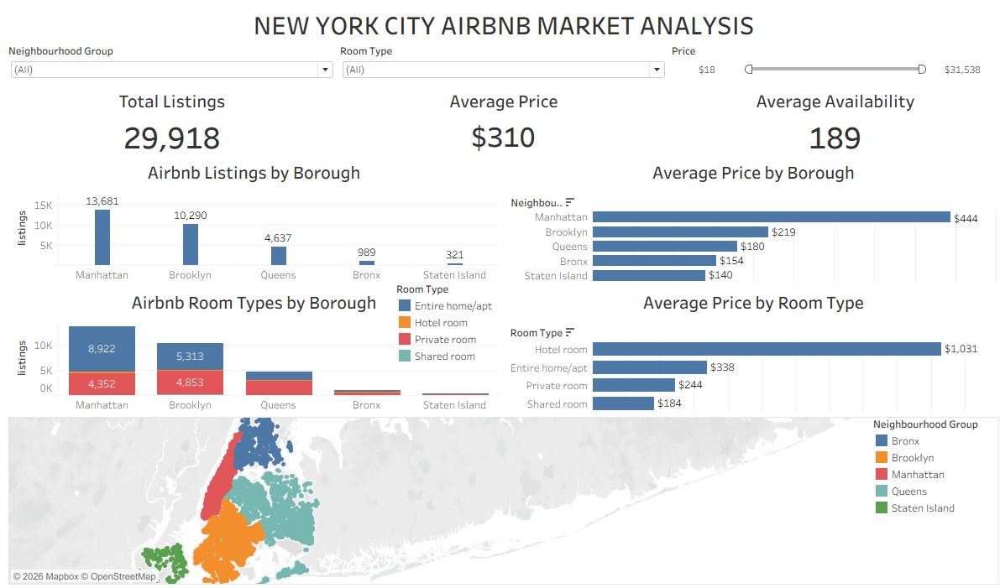
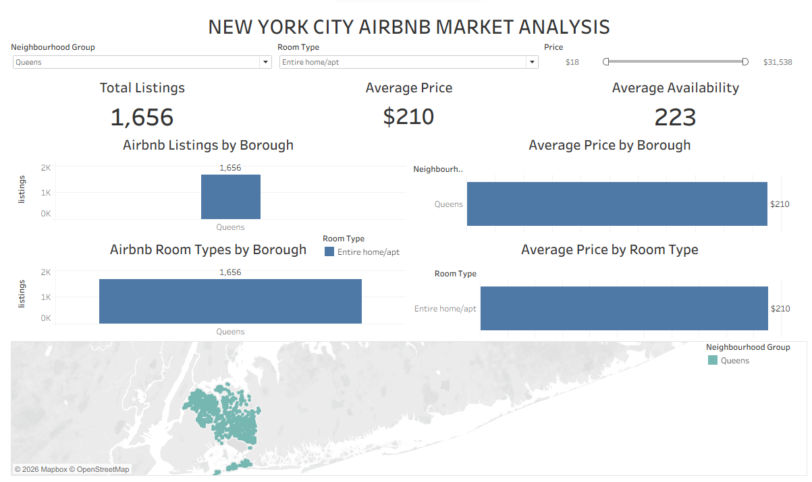
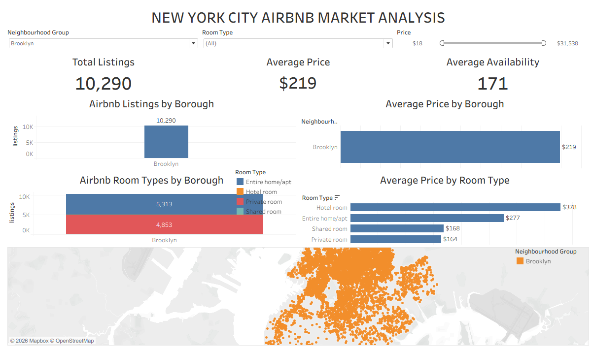

# New York City Airbnb Market Analysis | Tableau


🔗 **[View the interactive dashboard on Tableau Public](https://public.tableau.com/app/profile/hudu.yusuf.ibrahim/viz/NYCAirbnbMarketAnalysis_17927076299240/Dashboard1)**

## Project Overview

This project analyzes the New York City Airbnb market using Tableau. It looks at where listings are, how prices differ across boroughs and room types, and how listings are spread across the city.

An interactive dashboard lets users explore the market with borough, room type and price filters.

## Dashboard Preview



## Project Objectives

This project sets out to answer:

- How are Airbnb listings distributed across New York City's boroughs?
- How do average listing prices differ between boroughs?
- Which room types are most common, and how do their average prices compare?
- Where are listings located across the city?
- How do borough, room type and price filters change what the market looks like?

## Key Findings

- **Listings are concentrated in two boroughs.** Manhattan (13,681) and Brooklyn (10,290) hold about 80% of the 29,918 listings. Queens has 15.5%, and the Bronx and Staten Island together have under 5%.
- **Manhattan has the highest average price.** The average listing price is $444 in Manhattan, compared with $219 in Brooklyn, $180 in Queens, $154 in the Bronx and $140 in Staten Island.
- **Averages are pulled up by a few expensive listings.** The overall average price is $310, but the median is $182. Prices reach $31,538, so the median gives a better picture of a typical listing.
- **Entire homes and private rooms make up almost all listings.** Entire homes/apartments are 54.8% of listings and private rooms are 43.0%. Hotel rooms (1.5%) have the highest average price at $1,031, but this is based on only 429 priced listings.

## Dataset

The dataset contains New York City Airbnb listing information.

- **Number of records:** 29,918
- **Number of fields:** 24

Fields include listing ID, neighbourhood group (borough), neighbourhood, latitude and longitude, room type, price, minimum nights, number of reviews and availability throughout the year.

### Data Notes

- **Missing prices:** 10,512 listings (35%) have no price. All price figures use the 19,406 listings that do. The Bronx (765) and Staten Island (286) have few priced listings, so their averages are less reliable.
- **Listing ID:** Some IDs have 18 to 19 digits, and Tableau read them as blank when they were treated as numbers, which made the listing count too low (13,371). Converting the ID field to text fixed this, and the dashboard now counts all 29,918 listings.
- **Averages:** Average price is affected by very expensive listings, so the median ($182) is given alongside it above.

## Dashboard Features

### Key Performance Indicators

- **Total Listings:** 29,918
- **Average Listing Price:** $310
- **Average Availability:** 189 days per year

### Visualizations

1. **Airbnb Listings by Borough:** where listings are concentrated.
2. **Average Price by Borough:** how average prices differ across boroughs.
3. **Room Types by Borough:** how room types are distributed within each borough.
4. **Average Price by Room Type:** how average prices compare across accommodation types.
5. **Airbnb Listings Map:** the geographical spread of listings, using latitude and longitude.

### Interactive Filters

- **Neighbourhood Group:** filter by borough.
- **Room Type:** filter by accommodation type.
- **Price:** select a minimum and maximum listing price. Listings with no price are excluded once this filter is moved.

All filters apply to every chart, the KPI cards and the map.

## Screenshots

### Filtered view

*Filters update every chart, the KPI cards and the map.*

### Map view

*Listings by location, with one borough selected.*

## Tools Used

- **Tableau:** data visualization, mapping, KPI cards and interactive dashboard development
- **Microsoft Excel:** initial dataset inspection
- **GitHub:** project documentation

## Skills Demonstrated

- Data preparation and data-type validation
- Data quality checks
- KPI development
- Data visualization and geographic mapping
- Interactive dashboard design and filter configuration

## Project Structure

```text
airbnb-market-analysis/
│
├── dataset/
│   └── listings.csv
│
├── airbnb-dashboard-1.twb
│
├── screenshot/
│   ├── 01-dashboard-overview.png
│   ├── 02-filtered-view.png
│   └── 03-map-view.png
│
└── README.md
```

## Next Steps

A follow-up project will extend this analysis with deeper questions on pricing, availability and neighbourhood-level patterns.

## Author

**Hudu Yusuf Ibrahim**

Aspiring Data Analyst | Computer Engineering Graduate

- **LinkedIn:** https://www.linkedin.com/in/hudu-yusuf-ibrahim-ba06b5365
- **GitHub:** https://github.com/01Yusufh